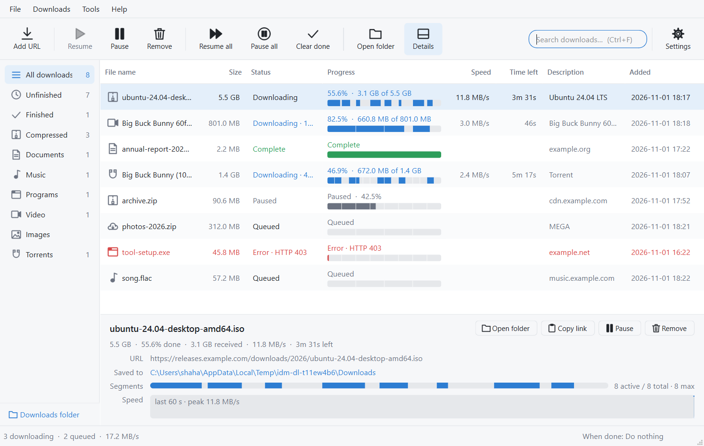
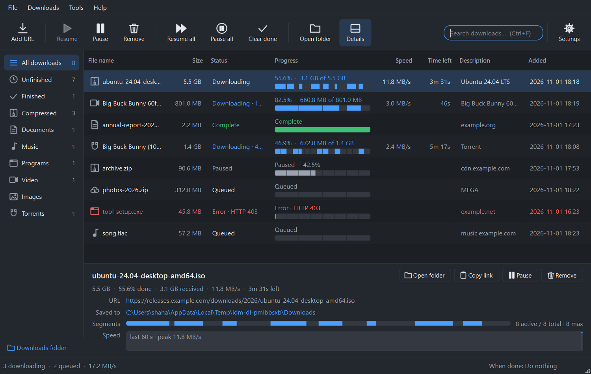
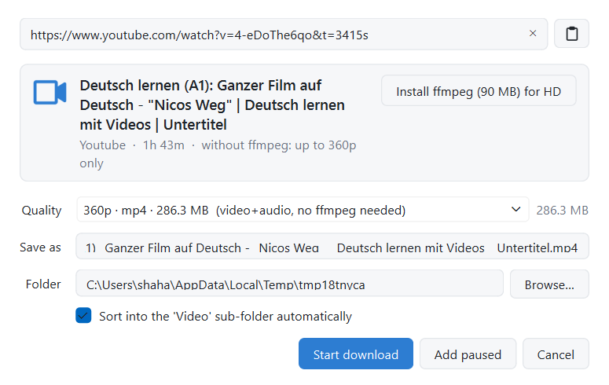
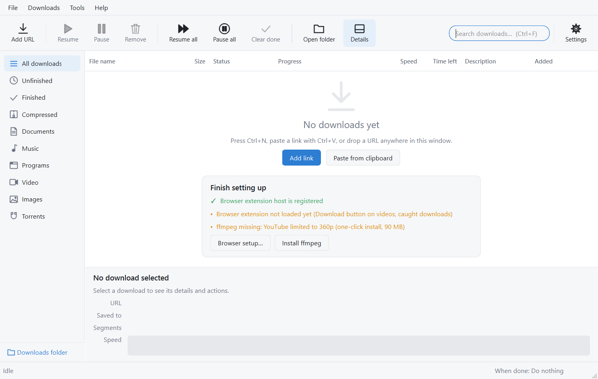
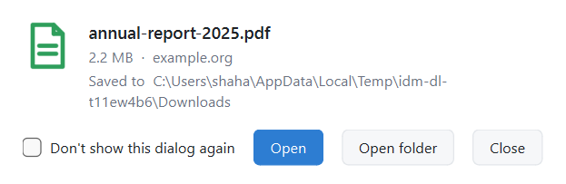

# IDM Clone

**An open-source all-in-one download manager for Windows**, in the spirit of Internet Download
Manager: segmented multi-connection downloads, pause and resume that survive restarts, a
browser extension that catches downloads and page videos, YouTube / Facebook / Instagram /
TikTok and 1000+ site video, audio and thumbnail downloads through yt-dlp, **BitTorrent**
(magnet links and .torrent files) and **MEGA** file and folder links.

[](https://github.com/shahadatjuton/idm-clone/actions/workflows/ci.yml)
[](LICENSE)




<details>
<summary>More screenshots</summary>

| Dark theme | Video download |
| --- | --- |
|  |  |

| First run | Download complete |
| --- | --- |
|  |  |

</details>

## Features

- **Fast downloads**: up to 32 parallel connections per file, dynamic re-splitting so every
  connection stays busy, a live segment map showing which parts have arrived. Right-click a
  running download to change its connection count or give it its own speed limit without
  stopping it.
- **Resume anything**: segment offsets are saved every two seconds. Pause, close, crash, or
  reboot and continue from the exact byte. Interrupted downloads resume automatically.
- **Browser integration** (Chrome, Edge, Brave, Firefox): catches downloads, lists video and audio
  streams playing on a tab, right-click "Download with IDM Clone", cookies and referrer
  forwarded so logged-in downloads work.
- **Video, audio and thumbnails**: YouTube, Facebook, Instagram, TikTok, Vimeo, Twitter, Twitch
  and everything yt-dlp supports. The quality picker lists every resolution and container
  (MP4, WebM, 3GP where the site offers it), audio-only (m4a or converted to MP3), and the
  thumbnail image on its own; a checkbox saves the thumbnail next to the video. One-click
  ffmpeg install for HD merging. **yt-dlp keeps itself current**: the newest release is fetched
  into the app data folder at startup and used instead of the bundled copy, so site breakages
  are fixed without waiting for a new app version.
- **Torrents**: paste a magnet link, open a .torrent file or link, or drop one on the window.
  Powered by libtorrent with DHT, peer exchange, UPnP, a live piece map in the progress bar,
  fast-resume data (no re-hashing after a restart), optional seeding, upload and connection
  limits, and an opt-in `magnet:` / `.torrent` handler so browser clicks open here.
- **MEGA**: file links and whole folder links (sub-folders kept). Files are fetched with the
  multi-connection engine and decrypted on the fly with the key from the link; the temporary
  download URL is refreshed automatically when you resume later.
- **Everything else**: EXE, MSI and APK installers, archives, documents and music go through the
  segmented engine and land in their category folders. Sites that ask for a username and
  password (HTTP Basic) get a login row in the add dialog; saved logins are encrypted with
  Windows DPAPI for your account and reused automatically.
- **Organised**: category folders (Video, Documents, Music, …), search, sortable columns
  including a Status column that names the failure ("Error · HTTP 403") and a Description
  column with the page title or site, a warning when a link is already in the list,
  queue reordering, batch add, clear finished, "Download complete" popup with Open and
  Open folder, "when done" exit / sleep / shut down, and a **scheduler** that runs the queue only
  inside a daily time window (23:00 to 07:00 on chosen weekdays, for example) and pauses whatever
  is still running when the window closes.
- **Pleasant**: light and dark themes that follow Windows, tray icon with notifications,
  clipboard watcher (file links, video pages, magnets and MEGA links), drag-and-drop,
  keyboard shortcuts.

## Download

Grab the latest build from the [Releases](https://github.com/shahadatjuton/idm-clone/releases/latest) page:

| File | What it is |
| --- | --- |
| `IDM-Clone-Setup-x.y.z.exe` | **Recommended.** Setup wizard: installs per-user (no admin prompt), Start Menu and desktop shortcuts, optional start with Windows, registers the browser host, uninstalls from *Apps & Features*. |
| `IDM Clone.exe` | Portable single file. No install, keeps settings in `%APPDATA%\idm-clone`. |
| `idm-clone-extension.zip` | The browser extension, if you did not use the installer. |

Requires Windows 10 or 11 (64-bit). Nothing else to install; ffmpeg can be added later from
inside the app for HD video.

> The builds are not code-signed yet. SmartScreen may show "Windows protected your PC" on
> first run: click *More info → Run anyway*. If **Smart App Control** is turned on
> (Windows 11, *Settings → Privacy & security → Windows Security → App & browser control*),
> it refuses unsigned apps outright with "An Application Control policy has blocked this
> file"; it cannot be bypassed per app. Until signed builds ship, run from source on such
> machines (`python -m idm`), which uses the signed Python interpreter.

## Browser setup (once)

The installer registers the native host for Chrome, Edge, Brave and Firefox, and the app opens a
**welcome window on first start** that walks you through the one remaining step. Loading
the extension is manual because it is not on the Chrome Web Store yet:

1. In the welcome window (or **Tools → Browser setup…** later) click **Open Google Chrome
   extensions** / **Open Microsoft Edge extensions**.
2. Turn on **Developer mode**, click **Load unpacked**, and choose the folder shown
   (**Copy path** puts it on your clipboard).
3. The window turns green the moment the extension connects.

**Firefox** has no "Load unpacked": open `about:debugging#/runtime/this-firefox`, click **Load
Temporary Add-on** and pick `manifest.json` inside the extension folder, then open the add-on's
*Permissions* tab and allow **Access your data for all websites** (Firefox does not grant host
permissions automatically). Temporary add-ons disappear when Firefox closes; a signed `.xpi`
that survives restarts will be published through addons.mozilla.org.

From then on, like IDM:

- a **Download** button appears over any video you hover on a web page: direct files are
  fetched straight away, players such as YouTube open the quality picker;
- downloads you start in the browser are caught and queued here, with cookies and referrer;
- clicking a **magnet link** on any page sends the torrent here instead of asking the browser
  which client to use (right-click → *Download link with IDM Clone* works too);
- the extension popup lists the media streams detected on the current tab and has toggles
  for each behaviour.

Running from source instead? `scripts\register-browser.ps1 -Dev` registers the host against
your checkout.

## Build from source

```powershell
git clone https://github.com/shahadatjuton/idm-clone.git
cd idm-clone
python -m venv .venv
.venv\Scripts\pip install -e .[dev]
.venv\Scripts\python -m idm                                          # run from source
powershell -ExecutionPolicy Bypass -File scripts\build-installer.ps1  # installer + portable exe (needs Inno Setup 6)
powershell -ExecutionPolicy Bypass -File scripts\build-exe.ps1        # portable exe only
```

Python 3.11+ is needed only for building. The release workflow in `.github/workflows`
produces the same artifacts on every `v*` tag.

## Video downloads and ffmpeg

YouTube serves video and audio as separate streams, so merging them needs ffmpeg. Without
it, the app falls back to YouTube's Android client, which still provides a combined 360p
MP4, and offers audio-only. The add dialog shows an **Install ffmpeg** button, and
*Settings › Video* has the same one-click download (static build from
[BtbN/FFmpeg-Builds](https://github.com/BtbN/FFmpeg-Builds), unpacked into
`%APPDATA%\idm-clone\ffmpeg`). With ffmpeg, every quality up to 4K is listed.

## Torrents and MEGA

- **Magnet links**: paste one into the add dialog (or just copy it: the clipboard watcher picks
  it up). The name, size and file list arrive from peers once the download starts.
- **.torrent files**: *File → Add torrent file…* (Ctrl+T), the magnet button in the add dialog,
  drag a file onto the window, or paste a link that ends in `.torrent`. The dialog shows the
  name, total size and the files inside before you start.
- **Settings → Torrents**: listening port, keep seeding when finished, upload limit, peer
  connections, extra trackers, and *Open magnet links and .torrent files with IDM Clone*
  (the installer offers the same as a task). Finished torrents go into the `Torrents`
  sub-folder when category sorting is on; the *Torrents* entry in the sidebar lists them.
- **MEGA**: paste a `mega.nz/file/…#key` or `mega.nz/folder/…#key` link. Folder links queue
  every file and keep the folder structure. MEGA limits free transfers per IP; when that
  happens the error says so and the download can be resumed later.

## Everyday use

| Action | How |
| --- | --- |
| Add a download | Ctrl+N, Ctrl+V with a link on the clipboard, drop a URL on the window, or double-click empty space |
| Add a torrent file | Ctrl+T, or drop the .torrent on the window |
| Add many | Paste several lines into the add dialog, or drop several links |
| Save a video's thumbnail | Right-click a video download → *Save thumbnail image* (or tick the box in the add dialog) |
| Pause / resume selected | Space |
| Open file (or folder if unfinished) | Enter or double-click |
| Remove selected | Delete |
| Copy link | Ctrl+C |
| Search | Ctrl+F; Esc clears |
| Sort | Click a column header; click the empty header area for queue order |
| Queue position | Right-click → Queue position |
| Details pane | Ctrl+D |
| Settings | Ctrl+, |

Terminal mode works too and detects video pages:

```powershell
idm-clone https://example.com/big.iso -n 16 -d D:\Downloads
idm-clone "https://www.youtube.com/watch?v=..."
idm-clone "magnet:?xt=urn:btih:..."
idm-clone "https://mega.nz/file/...#..."
idm-clone D:\Downloads\ubuntu.torrent
```

Settings and history live in `%APPDATA%\idm-clone`.

## How it works

A Qt-free asyncio engine (`src/idm/engine`) runs on a background thread and exposes a
thread-safe `DownloadManager`; the PySide6 UI (`src/idm/gui`) polls it; the browser
extension reaches it through a native messaging host and a token-protected localhost socket.
Torrents run in one shared libtorrent session inside the same engine; MEGA downloads reuse
the segmented HTTP engine with a per-connection AES-CTR decryptor, so they get the same
multi-connection speed and resume behaviour as plain files.

```
src/idm/engine/   probe, segmented downloads, yt-dlp media, torrents (libtorrent), MEGA, queue, IPC, settings
src/idm/gui/      PySide6 desktop UI
src/idm/native_host.py   Chrome/Edge native messaging host
extension/        Manifest V3 browser extension
packaging/        PyInstaller entry points
scripts/          build, install, and browser registration scripts
tests/            pytest suite (engine, GUI, browser integration)
```

## Contributing

Issues and pull requests are welcome. Dev setup:

```powershell
.venv\Scripts\pip install -e .[dev]
.venv\Scripts\python -m pytest      # 54 tests, run headless, isolated from your app data
.venv\Scripts
uff check . ; .venv\Scripts
uff format .
```

Keep the engine free of Qt imports and add a test for new behaviour; CI runs the same checks.

## License

[MIT](LICENSE). IDM Clone is an independent project and is not affiliated with Tonec Inc.
or Internet Download Manager. Downloading content is subject to the terms of the sites you
use it with.
