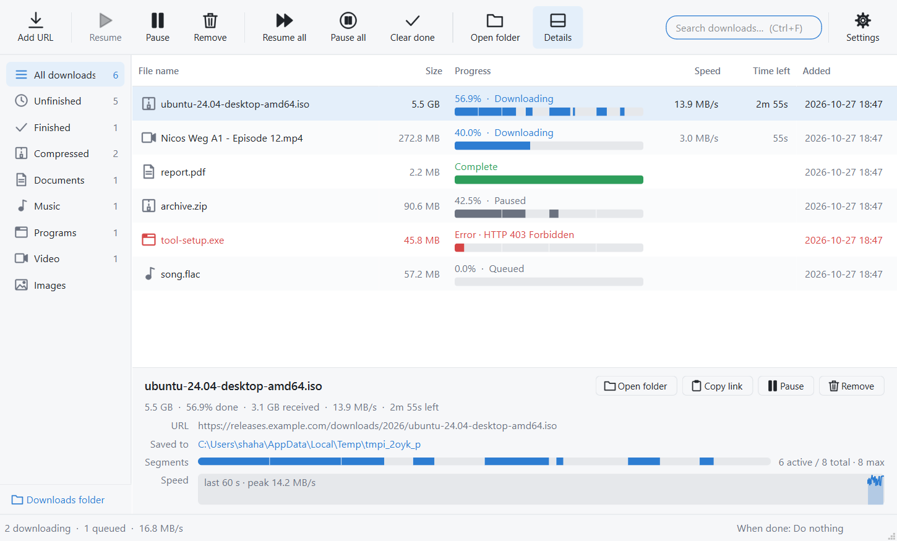
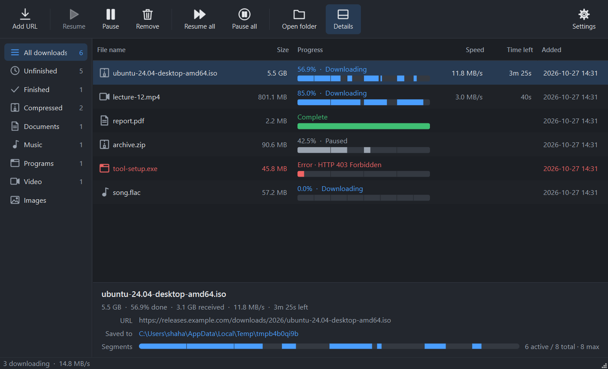
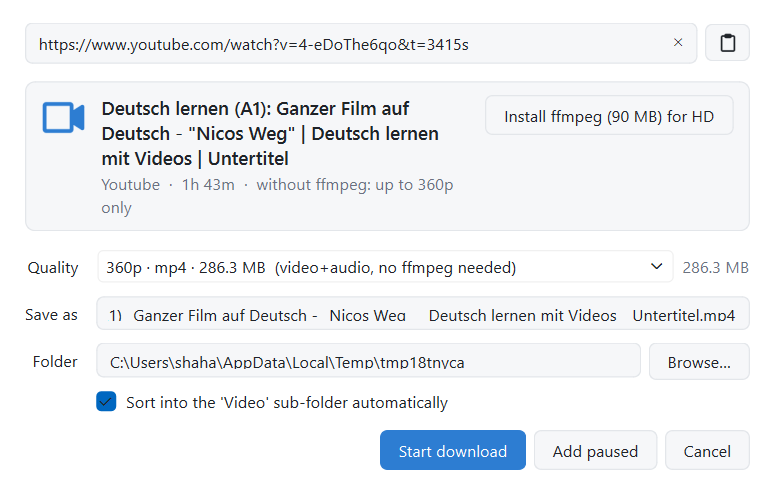
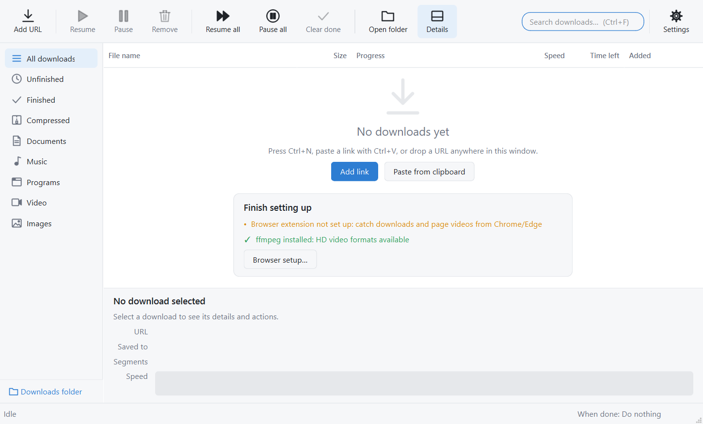
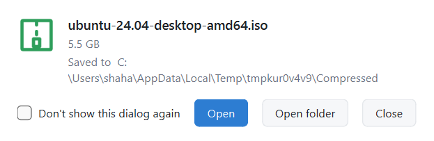

# IDM Clone

**An open-source download manager for Windows**, in the spirit of Internet Download Manager:
segmented multi-connection downloads, pause and resume that survive restarts, a browser
extension that catches downloads and page videos, and YouTube / 1000+ site video downloads
through yt-dlp.

[](https://github.com/shahadatjuton/idm-clone/actions/workflows/ci.yml)
[](LICENSE)




<details>
<summary>More screenshots</summary>

| Dark theme | Video download |
| --- | --- |
|  |  |

| First run | Download complete |
| --- | --- |
|  |  |

</details>

## Features

- **Fast downloads**: up to 32 parallel connections per file, dynamic re-splitting so every
  connection stays busy, a live segment map showing which parts have arrived.
- **Resume anything**: segment offsets are saved every two seconds. Pause, close, crash, or
  reboot and continue from the exact byte. Interrupted downloads resume automatically.
- **Browser integration** (Chrome, Edge, Brave): catches downloads, lists video and audio
  streams playing on a tab, right-click "Download with IDM Clone", cookies and referrer
  forwarded so logged-in downloads work.
- **Video downloads**: YouTube, Vimeo, Twitter, TikTok, Twitch and everything yt-dlp
  supports, with a quality picker, thumbnails, and one-click ffmpeg install for HD.
- **Organised**: category folders (Video, Documents, Music, …), search, sortable columns,
  queue reordering, batch add, clear finished, "Download complete" popup with Open and
  Open folder, "when done" exit / sleep / shut down.
- **Pleasant**: light and dark themes that follow Windows, tray icon with notifications,
  clipboard watcher, drag-and-drop, keyboard shortcuts.

## Download

Grab the latest build from the [Releases](https://github.com/shahadatjuton/idm-clone/releases/latest) page:

| File | What it is |
| --- | --- |
| `IDM-Clone-Setup-x.y.z.exe` | **Recommended.** Setup wizard: installs per-user (no admin prompt), Start Menu and desktop shortcuts, optional start with Windows, registers the browser host, uninstalls from *Apps & Features*. |
| `IDM Clone.exe` | Portable single file. No install, keeps settings in `%APPDATA%\idm-clone`. |
| `idm-clone-extension.zip` | The browser extension, if you did not use the installer. |

Requires Windows 10 or 11 (64-bit). Nothing else to install; ffmpeg can be added later from
inside the app for HD video.

> The builds are not code-signed yet. SmartScreen may show "Windows protected your PC" on
> first run: click *More info → Run anyway*. If **Smart App Control** is turned on
> (Windows 11, *Settings → Privacy & security → Windows Security → App & browser control*),
> it refuses unsigned apps outright with "An Application Control policy has blocked this
> file"; it cannot be bypassed per app. Until signed builds ship, run from source on such
> machines (`python -m idm`), which uses the signed Python interpreter.

## Browser setup (once)

The installer registers the native host for Chrome, Edge and Brave, and the app opens a
**welcome window on first start** that walks you through the one remaining step. Loading
the extension is manual because it is not on the Chrome Web Store yet:

1. In the welcome window (or **Tools → Browser setup…** later) click **Open Google Chrome
   extensions** / **Open Microsoft Edge extensions**.
2. Turn on **Developer mode**, click **Load unpacked**, and choose the folder shown
   (**Copy path** puts it on your clipboard).
3. The window turns green the moment the extension connects.

From then on, like IDM:

- a **Download** button appears over any video you hover on a web page: direct files are
  fetched straight away, players such as YouTube open the quality picker;
- downloads you start in the browser are caught and queued here, with cookies and referrer;
- the extension popup lists the media streams detected on the current tab and has toggles
  for each behaviour.

Running from source instead? `scripts\register-browser.ps1 -Dev` registers the host against
your checkout.

## Build from source

```powershell
git clone https://github.com/shahadatjuton/idm-clone.git
cd idm-clone
python -m venv .venv
.venv\Scripts\pip install -e .[dev]
.venv\Scripts\python -m idm                                          # run from source
powershell -ExecutionPolicy Bypass -File scripts\build-installer.ps1  # installer + portable exe (needs Inno Setup 6)
powershell -ExecutionPolicy Bypass -File scripts\build-exe.ps1        # portable exe only
```

Python 3.11+ is needed only for building. The release workflow in `.github/workflows`
produces the same artifacts on every `v*` tag.

## Video downloads and ffmpeg

YouTube serves video and audio as separate streams, so merging them needs ffmpeg. Without
it, the app falls back to YouTube's Android client, which still provides a combined 360p
MP4, and offers audio-only. The add dialog shows an **Install ffmpeg** button, and
*Settings › Video* has the same one-click download (static build from
[BtbN/FFmpeg-Builds](https://github.com/BtbN/FFmpeg-Builds), unpacked into
`%APPDATA%\idm-clone\ffmpeg`). With ffmpeg, every quality up to 4K is listed.

## Everyday use

| Action | How |
| --- | --- |
| Add a download | Ctrl+N, Ctrl+V with a link on the clipboard, drop a URL on the window, or double-click empty space |
| Add many | Paste several lines into the add dialog, or drop several links |
| Pause / resume selected | Space |
| Open file (or folder if unfinished) | Enter or double-click |
| Remove selected | Delete |
| Copy link | Ctrl+C |
| Search | Ctrl+F; Esc clears |
| Sort | Click a column header; click the empty header area for queue order |
| Queue position | Right-click → Queue position |
| Details pane | Ctrl+D |
| Settings | Ctrl+, |

Terminal mode works too and detects video pages:

```powershell
idm-clone https://example.com/big.iso -n 16 -d D:\Downloads
idm-clone "https://www.youtube.com/watch?v=..."
```

Settings and history live in `%APPDATA%\idm-clone`.

## How it works

A Qt-free asyncio engine (`src/idm/engine`) runs on a background thread and exposes a
thread-safe `DownloadManager`; the PySide6 UI (`src/idm/gui`) polls it; the browser
extension reaches it through a native messaging host and a token-protected localhost socket.

```
src/idm/engine/   probe, segmented downloads, yt-dlp media, queue, IPC, settings
src/idm/gui/      PySide6 desktop UI
src/idm/native_host.py   Chrome/Edge native messaging host
extension/        Manifest V3 browser extension
packaging/        PyInstaller entry points
scripts/          build, install, and browser registration scripts
tests/            pytest suite (engine, GUI, browser integration)
```

## Contributing

Issues and pull requests are welcome. Dev setup:

```powershell
.venv\Scripts\pip install -e .[dev]
.venv\Scripts\python -m pytest      # 30 tests, run headless, isolated from your app data
.venv\Scripts
uff check . ; .venv\Scripts
uff format .
```

Keep the engine free of Qt imports and add a test for new behaviour; CI runs the same checks.

## License

[MIT](LICENSE). IDM Clone is an independent project and is not affiliated with Tonec Inc.
or Internet Download Manager. Downloading content is subject to the terms of the sites you
use it with.
